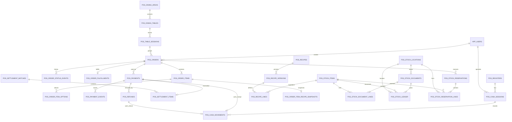

# POS V3 — ERD یکپارچه هسته سفارش، پرداخت، صندوق و انبار

- تاریخ: 2026-11-19
- وضعیت: **طرح یکپارچه منطقی؛ آماده بازبینی فنی پیش از طراحی DDL**
- شاخه: `feature/3food-pos-next-release-v2`
- دامنه: نسخه تجاری تک‌شعبه‌ای غذا و نوشیدنی
- منابع: `ORDER_DATA_MODEL_V3.md`، `PAYMENT_LEDGER_V3.md`، `FINANCE_INVENTORY_DATA_MODEL_V3.md`

> این سند یکپارچگی رابطه‌ها و invariantهای بین دامنه‌ها را مشخص می‌کند. DDL اجرایی، migration، API و تغییر schema در این بسته انجام نشده است.

## 1. اصول مرجعیت داده

| دامنه | منبع حقیقت | چیزی که منبع حقیقت آن نیست |
|---|---|---|
| سفارش | `pos_orders` و ردیف‌ها/رویدادهای سفارش | وضعیت پرداخت یا مانده مالی |
| پرداخت | `pos_payments`، `pos_payment_events`، `pos_refunds` | حرکت فیزیکی وجه نقد |
| صندوق | `pos_cash_sessions` و `pos_cash_movements` | دریافت کارت/درگاه یا وضعیت سفارش |
| تسویه | `pos_settlement_batches` و `pos_settlement_items` | پرداخت جدید یا حرکت صندوق |
| موجودی | اسناد posted و `pos_stock_ledger` | موجودی cache/projection |
| رزرو | `pos_stock_reservations` و خطوط/رویدادهای آن | مصرف قطعی یا گردش ledger |
| ارزش‌گذاری | لایه Moving Weighted Average و cost snapshot خروج | قیمت خرید فعلی به‌عنوان بازنویسی هزینه گذشته |

همه postingهای مالی و انبار باید transaction اتمیک، idempotency و قفل/کنترل هم‌زمانی داشته باشند. سند و ledger ثبت‌شده append-only هستند؛ اصلاح با سند معکوس یا adjustment جدید انجام می‌شود.

## 2. ERD منطقی یکپارچه

ERD فوق مفهومی است؛ جدول snapshot رسپی سفارش و اتصال دقیق eventهای رزرو/مصرف در طراحی فیزیکی با قراردادهای idempotency نهایی می‌شوند.

## 3. قراردادهای کلیدی بین دامنه‌ها

### 3.1 سفارش و پرداخت
- هر سفارش یک تا چند ردیف و صفر تا چند پرداخت دارد؛ سفارش حضوری می‌تواند تا دریافت وجه با مانده باز بماند.
- پرداخت ترکیبی با چند رکورد `pos_payments` ثبت می‌شود؛ جمع پرداخت‌های موفق از مبلغ قابل پرداخت سفارش بیشتر نمی‌شود، مگر مسیر اضافه‌پرداخت مستقل و مصوب.
- `pos_orders.payment_status` فقط projection قابل query از ledger است و نباید از API عمومی مستقیماً تغییر کند.
- لغو سفارش، refund نیست. سفارش پرداخت‌شده تنها پس از refund ثبت‌شده یا فرایند مغایرت مجاز قابل تعیین تکلیف مالی است.
- `awaiting_payment` برای checkout storefront است؛ callback مرورگر به‌تنهایی پرداخت را موفق نمی‌کند.

### 3.2 پرداخت و صندوق
- هر پرداخت نقدی موفق دقیقاً یک cash movement ورودی در cash session باز مربوط ایجاد می‌کند.
- هر refund نقدی موفق دقیقاً یک cash movement خروجی ایجاد می‌کند.
- payment کارتخوان و درگاه در `pos_cash_movements` ثبت نمی‌شوند؛ آن‌ها فقط به session/actor برای ردیابی عملیات مرتبط می‌شوند، نه به‌عنوان وجه نقد کشو.
- رابطه cash movement به payment/refund باید unique و idempotent باشد تا retry دوباره‌کاری نسازد.
- هر صندوق در هر لحظه حداکثر یک cash session باز دارد. هر session یک مسئول اصلی دارد؛ عملیات همکاران با actor مستقل ثبت می‌شود.
- بستن با اختلاف غیرصفر: session وارد `requires_review` می‌شود؛ تراکنش جدید نمی‌پذیرد و نهایی‌سازی مغایرت نیازمند مدیر است.

### 3.3 تسویه
- هر settlement item به یک payment داخلی و شناسه provider متصل است.
- settlement صرفاً تطبیق گزارش دوره‌ای provider است؛ ایجاد payment یا cash movement نمی‌کند.
- ورود تکراری فایل/گزارش با fingerprint و idempotency کنترل می‌شود؛ مغایرت بدون actor و علت بسته نمی‌شود.

### 3.4 سفارش، رسپی و موجودی
- هر order item هنگام پذیرش، نسخه رسپی و مواد/مقادیر مؤثر را snapshot می‌کند؛ تغییر رسپی آینده سفارش قبلی را تغییر نمی‌دهد.
- در POS، رزرو مواد در پذیرش سفارش انجام می‌شود و هنگام شروع آماده‌سازی به مصرف ledger تبدیل می‌شود.
- برای storefront با پرداخت درگاه، رزرو موقت checkout با TTL اعمال می‌شود؛ نتیجه مبهم پرداخت رزرو را فوراً آزاد نمی‌کند.
- لغو قبل از مصرف، رزرو را آزاد می‌کند؛ لغو بعد از مصرف با برگشت واقعی مواد یا سند waste/return ثبت می‌شود.
- رزرو موجودی از موجودی ledger/projection کم می‌شود اما تا زمان posting مصرف، خروج قطعی موجودی محسوب نمی‌شود.
- `pos_stock_balances` فقط projection قابل بازسازی است و نباید مستقیماً ویرایش شود.

### 3.5 خرید و ارزش‌گذاری
- رسید خرید مستقیم، سند ورودی stock و ledger ورودی می‌سازد؛ ماژول سفارش خرید/حساب پرداختنی در MVP نیست.
- Moving Weighted Average به تفکیک stock item و location روش ارزش‌گذاری نسخه اول است.
- خروج مصرفی cost snapshot زمان posting را ثبت می‌کند؛ رسید خرید بعدی بهای خروج گذشته را بازنویسی نمی‌کند.
- batch/pre-preparation در MVP نیست؛ هیچ موجودی نیمه‌آماده‌ای بدون سند تولید متوازن ایجاد نمی‌شود.

## 4. قیود FK، یکتایی و حذف

- همه اسناد دارای سابقه عملیاتی با FKهای `ON DELETE RESTRICT` محافظت شوند؛ حذف عادی به archive/disable تبدیل شود.
- order items، payment events، refunds، cash movements، stock documents/ledger و settlement records حذف یا update عمومی نداشته باشند.
- هر payment دارای idempotency key در دامنه مناسب و provider reference یکتا در صورت وجود باشد.
- هر refund به payment و order اصلی متصل باشد؛ مجموع refundهای موفق از مبلغ پرداخت موفق همان payment بیشتر نشود.
- هر cash movement مرجع مالی اختیاری یکتا داشته باشد؛ یک payment/refund نقدی نمی‌تواند دو movement متناظر ایجاد کند.
- برای هر register حداکثر یک session باز؛ اعمال constraint فیزیکی یا راهکار transaction-safe سازگار با MySQL/MariaDB در DDL تعیین شود.
- هر table حداکثر یک table session فعال داشته باشد؛ باز/بستن نشست با قفل ردیف میز و transaction انجام شود.
- هر stock ledger row به stock item، location، سند مرجع و source event یکتا متصل باشد.
- انتقال بین دو location در یک transaction دو اثر متوازن می‌سازد.
- مقدارهای stock با DECIMAL (پیشنهاد `DECIMAL(18,6)`) و مبالغ با عدد صحیح و ارز `IRT` ذخیره شوند؛ float ممنوع.
- FKها و indexها برای queryهای صف سفارش، پرداخت‌های نامشخص، session باز، موجودی قلم/محل و گردش ledger طراحی شوند.

## 5. تنظیمات شمارشی و فعال‌سازی

- تعداد صندوق و محل نگهداری در نصب تک‌شعبه‌ای از تنظیمات کسب‌وکار قابل تعیین است.
- ایجاد/فعال‌سازی resource فقط در صورت روشن‌بودن قابلیت و رعایت سقف مجاز Backend انجام می‌شود.
- بررسی سقف باید در transaction/قفل مناسب باشد تا درخواست‌های هم‌زمان از حد عبور نکنند.
- غیرفعال‌سازی resource دارای سابقه، داده را حذف نمی‌کند؛ صندوق دارای session باز یا location دارای عملیات باز تا تعیین تکلیف غیرفعال نمی‌شود.
- هیچ عدد نمونه‌ای در UI یا سند به‌عنوان سقف ثابت محصول hard-code نشود.

## 6. دروازه ورود به DDL

پیش از نوشتن schema باید این موارد بسته شوند:
1. نام و نوع دقیق کلیدهای PK/FK، نوع UUID/BIGINT و استاندارد شناسه در کل schema.
2. قرارداد دقیق snapshot رسپی در order item و رابطه با preparation task.
3. قرارداد یکپارچه terminal transaction با payment ledger؛ مرجع provider و idempotency.
4. ساختار نهایی expense/supplier payout و اتصال آن به cash movement بدون ادعای حسابداری کامل.
5. سیاست projection و rebuild موجودی و valuation؛ رفتار ارزش‌گذاری هنگام موجودی منفی.
6. index plan و قیود سازگار با حداقل نسخه واقعی MySQL/MariaDB روی هاست هدف.
7. تست نصب تازه، اجرای دوباره migration، rollback، backup/restore و race condition.

تا عبور از این دروازه، این سند ERD منطقی است و نه DDL قابل اجرا.
