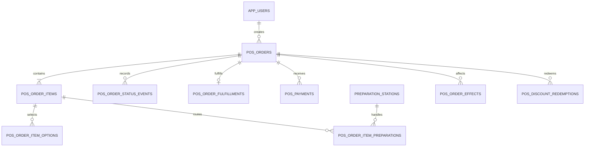

# POS V3 — مدل داده سفارش و ERD نسخه تجاری

- تاریخ: 2026-11-19
- وضعیت: طراحی منطقی به‌همراه تصمیم‌های فنی پیشنهادی؛ هنوز schema اجرایی و مورد تأیید مالک نیست.
- مرجع چرخه عملیاتی: `ORDER_LIFECYCLE_STOREFRONT_V3.md`
- مرجع مالی: `PAYMENT_LEDGER_V3.md` و `FINANCE_INVENTORY_DATA_MODEL_V3.md`
- هدف نصب: دیتابیس تازه MySQL/InnoDB؛ بدون انتقال داده V2.

## 1. یافته از schema فعلی

بازبینی `php-backend/schema.sql` نشان می‌دهد:
- `pos_orders` اکنون یک وضعیت عملیاتی محدود، `payment_method` و payloadهای JSON برای items/totals دارد.
- کانال سفارش، نوع دریافت، وضعیت مستقل پرداخت/تحویل و تاریخچه وضعیت مستقل مدل نشده‌اند.
- ردیف‌های سفارش و گزینه‌های انتخابی به‌صورت رابطه‌ای و snapshot مستقل قابل query نیستند.
- `pos_order_effects` برای اثرهای برگشت‌پذیر موجودی/مشتری وجود دارد و باید به سفارش پایدار متصل بماند.
- `pos_records` مخزن عمومی JSON برای چند resource است؛ برای اسناد حیاتی سفارش/پرداخت/موجودی نباید منبع حقیقت اصلی باقی بماند.
- `pos_terminal_payments` تراکنش کارتخوان را ثبت می‌کند، اما جای دفتر عمومی پرداخت را نمی‌گیرد.

این یافته‌ها صرفاً مبنای طراحی‌اند؛ هیچ جدول فعلی در این مرحله حذف یا تغییر داده نشده است.

## 2. اصول مدل داده

1. یک سفارش با چند ردیف مستقل؛ هر ردیف snapshot نام، شناسه محصول، قیمت و گزینه‌ها را حفظ می‌کند.
2. کانال سفارش، نوع دریافت، وضعیت عملیاتی، آماده‌سازی، تحویل و پرداخت مستقل‌اند.
3. مبلغ‌ها با عدد صحیح در کوچک‌ترین واحد تجاری مصوب (در محصول فعلی تومان) ذخیره می‌شوند؛ واحد در کل سیستم ثابت و صریح است.
4. سفارش ثبت‌شده، ردیف‌ها، قیمت‌ها و رویدادهای گذشته با ویرایش کاتالوگ تغییر نمی‌کنند.
5. تغییر وضعیت فقط از transition معتبر عبور می‌کند و event append-only می‌سازد.
6. idempotency برای سفارش عمومی و داخلی الزامی است.
7. هم‌زمانی موجودی و رزرو باید در transaction و با قفل/کنترل نسخه انجام شود.
8. داده عمومی مشتری از طریق token hash غیرقابل حدس قابل دسترسی باشد؛ شناسه ترتیبی سفارش به‌تنهایی مجوز دسترسی نیست.
9. داده‌های عملیاتی سفارش رابطه‌ای باشند؛ JSON فقط برای snapshot/metadata محدود و نسخه‌بندی‌شده به کار رود.
10. این مدل در نسخه اول تک‌شعبه‌ای قابل اجراست؛ شناسه کسب‌وکار/شعبه در صورت نیاز آینده به شکل کنترل‌شده افزوده می‌شود، بدون ورود UI چندشعبه‌ای به نسخه اول.

## 3. ERD مفهومی

## 4. جداول سفارش

### 4.1 `pos_orders` — سربرگ سفارش

فیلدهای پیشنهادی:
- `id` BIGINT UNSIGNED PK.
- `order_number` BIGINT UNSIGNED؛ شماره نمایشی یکتا و قابل تنظیم از شمارنده.
- `source_channel` ENUM: `pos_counter, staff_phone, staff_manual, table_service, takeaway, storefront, external_integration`.
- `order_type` ENUM: `dine_in, takeaway, delivery`.
- `status` ENUM: `draft, placed, confirmed, preparing, ready, completed, cancelled`.
- `fulfillment_status` ENUM: `not_applicable, awaiting_pickup, assigned, out_for_delivery, delivered, delivery_failed`.
- `payment_status` ENUM: `unpaid, partially_paid, paid, partially_refunded, refunded, reconciliation_required`; خلاصه‌ای که از دفتر پرداخت محاسبه و در transaction به‌روز می‌شود، نه منبع حقیقت مستقل.
- `customer_id` nullable و `customer_name_snapshot`, `customer_phone_snapshot`.
- `created_by` nullable فقط برای سفارش عمومی storefront؛ `created_by_channel`/actor مشخص می‌کند مشتری یا کارمند سفارش را ثبت کرده است.
- `idempotency_key` و `request_hash` با unique constraint مناسب.
- `subtotal_amount`, `discount_amount`, `tax_amount`, `delivery_fee_amount`, `total_amount` با BIGINT UNSIGNED و واحد پول ثابت.
- `currency` CHAR(3) با مقدار مصوب `IRT`.
- `customer_note` و `internal_note` جدا؛ یادداشت داخلی هرگز به storefront یا آشپزخانه‌ای که مجوز ندارد نشت نکند.
- `placed_at`, `completed_at`, `cancelled_at`, `created_at`, `updated_at`.
- Index روی `(status, created_at)`, `(source_channel, created_at)`, `(payment_status, created_at)`, `(customer_id, created_at)`.
- شماره سفارش و کلید idempotency با unique index محافظت شوند.

قید مهم: سفارش `storefront` می‌تواند actor کارمند نداشته باشد؛ مسیرهای داخلی باید همچنان actor احراز هویت‌شده و مجاز داشته باشند.

### 4.2 `pos_order_items` — ردیف‌های سفارش

- `id` BIGINT UNSIGNED PK و `order_id` FK.
- `product_id` شناسه مرجع محصول nullable برای محصولی که بعداً حذف/غیرفعال می‌شود.
- `sku_snapshot` اختیاری، `name_snapshot`, `description_snapshot`.
- `quantity` DECIMAL(14,3) و `unit_label_snapshot`.
- `unit_price_amount`, `discount_amount`, `tax_amount`, `line_total_amount` عدد صحیح.
- `recipe_snapshot_version`/metadata محدود در صورت اتصال رسپی.
- `line_note`, `sort_order`, timestamps.
- FK به سفارش با ON DELETE RESTRICT؛ اسناد سفارش حذف فیزیکی نشوند.

### 4.3 `pos_order_item_options` — افزودنی و انتخاب محصول

- `id`, `order_item_id` FK.
- `option_group_id` nullable؛ `option_id` nullable.
- `group_name_snapshot`, `option_name_snapshot`.
- `quantity` DECIMAL(14,3), `unit_price_delta_amount`, `total_delta_amount`.
- `is_required_snapshot`, `sort_order`.
- انتخاب‌های آزاد/متنی فقط با validation و محدودیت طول ذخیره شوند.
- Snapshot باید برای چاپ و بازبینی سفارش کافی باشد، حتی اگر گزینه از کاتالوگ حذف شود.

## 5. رویدادها و آماده‌سازی

### 5.1 `pos_order_status_events`
Append-only:
- `id`, `order_id`, `from_status`, `to_status`, `reason_code`, `reason_text`.
- `actor_user_id` nullable برای رویداد مشتری/سیستم؛ `actor_type` و `source_channel`.
- `idempotency_key` nullable/unique در دامنه مناسب.
- `metadata` JSON پالایش‌شده و نسخه‌بندی‌شده.
- `created_at`; index بر order/time.
- API نباید update/delete عمومی برای event فراهم کند.

### 5.2 `preparation_stations`
- شناسه، نام، نوع (kitchen/bar/packing/other)، فعال‌بودن، ترتیب و تنظیمات چاپ.
- برای نسخه اول یک کسب‌وکار می‌تواند یک یا چند ایستگاه تعریف کند.

### 5.3 `pos_order_item_preparations`
- `id`, `order_item_id`, `station_id`.
- `status`: `queued, preparing, ready, cancelled`.
- `quantity`, زمان شروع/پایان، عامل شروع/تکمیل و timestamps.
- یک ردیف سفارش می‌تواند چند task داشته باشد؛ کل سفارش زمانی ready می‌شود که همه taskهای لازم آماده باشند و قواعد تحویل/پرداخت اجازه دهد.

## 6. دریافت و ارسال

### 6.1 `pos_order_fulfillments`
یک رکورد fulfillment برای هر سفارش نسخه اول:
- `order_id` unique FK.
- `method`: `dine_in, pickup, delivery`.
- `status`: وضعیت‌های تحویل تعریف‌شده در چرخه سفارش.
- `table_label_snapshot` یا `table_id` در صورت میز.
- `recipient_name`, `recipient_phone`, `address_snapshot` فقط برای delivery.
- `delivery_fee_amount`, `scheduled_for`, `estimated_ready_at`.
- `courier_user_id` nullable؛ بدون فرض اپ پیک مستقل.
- timestamps و علت شکست/لغو.
- دسترسی به نشانی فقط برای نقش‌های لازم؛ آشپزخانه این داده را دریافت نمی‌کند.

### 6.2 کنترل اطلاعات عمومی سفارش
- برای پیگیری storefront، `public_tracking_token_hash` یا token جداگانه در جدول access نگهداری شود؛ token خام فقط یک‌بار به مشتری داده شود.
- endpoint عمومی باید اطلاعات حداقلی و rate-limited برگرداند.
- اطلاعات تماس/نشانی و یادداشت داخلی از پاسخ عمومی حذف شوند.

## 7. ارتباط با دفتر پرداخت

- `pos_payments.order_id` به `pos_orders.id` متصل است.
- هر سفارش می‌تواند صفر تا چند payment داشته باشد.
- روش پرداخت از source_channel مستقل است.
- callback درگاه فقط پس از تأیید server-to-server یک payment موفق ایجاد/تکمیل می‌کند.
- خلاصه `payment_status` باید از payment/refund ledger بازسازی‌پذیر باشد.
- لغو سفارش و refund عملیات جدا هستند.

## 8. رابطه با موجودی و رسپی

- کسر/رزرو مواد از یک مسیر مرکزی انجام شود تا POS و storefront دو بار موجودی را تغییر ندهند.
- `pos_order_effects` فقط اثرهای دقیق و برگشت‌پذیر سفارش را نگه می‌دارد؛ ledger عمومی موجودی در طراحی انبار جداگانه منبع حقیقت گردش موجودی خواهد بود.
- در سفارش دارای رسپی، snapshot نسخه رسپی هنگام ثبت سفارش حفظ شود.
- لغو/مرجوعی، اثر موجودی را طبق سیاست مصوب و با event/ledger معکوس کند؛ حذف اثر قبلی مجاز نیست.

## 9. تصمیم‌های معماری پیشنهادی برای بستن موارد باز

وضعیت این تصمیم‌ها: **تصمیم معماری اتخاذ شد؛ مبنای ERD نهایی و DDL پس از دروازه پذیرش.**
این تصمیم‌ها برای نسخه اول غذا و نوشیدنی انتخاب شده‌اند تا مدل قابل کنترل، قابل گزارش و قابل توسعه بماند.

### 9.1 وضعیت‌ها و transitionها
- وضعیت‌های عملیاتی به‌صورت کدهای ثابت و کنترل‌شده در دامنه نگهداری شوند؛ کسب‌وکار نتواند وضعیت دلخواه بسازد یا transition امنیتی را حذف کند.
- کدهای پایه سفارش: `draft`, `awaiting_payment`, `placed`, `confirmed`, `preparing`, `ready`, `completed`, `cancelled`.
- `awaiting_payment` برای سفارش storefront است که checkout آن ثبت شده اما پرداخت/پذیرش نهایی هنوز تعیین تکلیف نشده؛ در این وضعیت به صف آماده‌سازی ارسال نمی‌شود.
- transitionها در یک جدول عمومی قابل‌ویرایش توسط مشتری ذخیره نشوند؛ ماتریس مجاز در Domain Service تعریف و با تست پوشش داده شود. توسعه نسخه‌ای می‌تواند transitionهای جدید را با migration و کد اضافه کند.
- وضعیت fulfillment و taskهای آماده‌سازی مستقل می‌مانند. تغییر وضعیت فقط از سرویس دامنه و همراه event append-only انجام می‌شود.
- وضعیت پرداخت از ledger محاسبه و در `pos_orders.payment_status` به‌عنوان خلاصه قابل query نگهداری می‌شود؛ هیچ API اجازه تغییر مستقیم آن را ندارد.

### 9.2 مدل میز و سالن
- برای نسخه اول، مدل رابطه‌ای واقعی پیشنهاد می‌شود؛ صرفاً ذخیره نام میز در snapshot برای عملیات رستوران کافی نیست.
- موجودیت‌های پایه: `pos_dining_areas` (سالن/بخش)، `pos_dining_tables` (میز با کد/نام، ظرفیت، وضعیت فعال و ترتیب) و `pos_table_sessions` (نشست باز خدمت‌رسانی).
- هر نشست به یک میز متصل است و می‌تواند چند سفارش/نوبت سفارش داشته باشد؛ هر سفارش میز به نشست و میز مربوط متصل می‌شود.
- باز/بسته‌کردن نشست و انتقال/ادغام میز باید عملیات مجاز، تراکنشی و auditشده باشد. در هر میز حداکثر یک نشست فعال مجاز است؛ این invariant با قفل‌گذاری ردیف میز و کنترل Backend اعمال می‌شود، نه صرفاً اتکا به UI.
- برای حفظ سابقه، نام/کد میز و سالن در snapshot سفارش نیز ثبت می‌شود. حذف فیزیکی میز/سالن دارای سابقه ممنوع و غیرفعال‌سازی مجاز است.
- جزئیات تقسیم صورتحساب، ادغام سفارش و انتقال میز در طراحی جریان POS تکمیل می‌شود؛ این ERD فقط رابطه‌های پایدار را تثبیت می‌کند.

### 9.3 سفارش storefront پیش از پرداخت
- سبد خرید تا پیش از ارسال checkout در مرورگر/کلاینت باقی می‌ماند؛ با ثبت checkout، سفارش پایدار با وضعیت `awaiting_payment` ساخته می‌شود.
- برای پرداخت اینترنتی، یک `pos_payments` با وضعیت `pending` و مرجع intent در همان جریان idempotent ساخته می‌شود؛ payment intent موجودیت مستقل از order نیست و به سفارش متصل است.
- سفارش تنها پس از تأیید معتبر server-to-server یا استعلام قطعی provider و اعمال policy پذیرش، وارد `placed` یا `confirmed` می‌شود.
- پرداخت ناموفق/لغوشده، سفارش را خودکار paid یا پذیرفته‌شده نمی‌کند. سفارش منقضی‌شده با event مشخص بسته و رزروهایش آزاد می‌شوند.
- پرداخت در محل مسیر جداست: پس از اعتبارسنجی policy و پذیرش کسب‌وکار، سفارش می‌تواند بدون payment موفق وارد صف عملیاتی شود و `payment_status=unpaid` باقی بماند.
- نتیجه مبهم provider برابر موفقیت نیست؛ سفارش در `awaiting_payment` و پرداخت در وضعیت نامشخص/نیازمند تطبیق می‌ماند تا استعلام یا رسیدگی معتبر انجام شود.

### 9.4 پذیرش سفارش و پرداخت در محل
- پذیرش خودکار یا دستی، و مجازبودن پرداخت در محل، تنظیمات کسب‌وکار هستند؛ اما فقط در محدوده entitlement و policy مرکزی.
- پیش‌فرض امن storefront: سفارش پرداخت‌شونده با درگاه تا تأیید پرداخت وارد صف آماده‌سازی نشود؛ سفارش پرداخت در محل فقط در صورت فعال‌بودن روش و پذیرش خودکار یا تأیید کارمند مجاز پذیرفته شود.
- رد سفارش باید علت، عامل و زمان داشته باشد. رد/لغو سفارش جایگزین refund نیست و اگر وجهی دریافت شده باشد، فرایند refund مستقل لازم است.
- در POS حضوری، ثبت سفارش و دریافت وجه از هم مستقل‌اند؛ سفارش می‌تواند تا تسویه با مانده باز باقی بماند، مطابق مجوز و policy.

### 9.5 حذف و غیرفعال‌سازی محصول
- محصول دارای ارجاع تاریخی حذف فیزیکی نمی‌شود؛ به‌صورت archive/غیرفعال درمی‌آید و از فروش جدید خارج می‌شود.
- `product_id` در ردیف سفارش در حالت عادی FK با `ON DELETE RESTRICT` خواهد داشت؛ snapshotهای نام، SKU، گزینه و قیمت مرجع تاریخی هستند.
- اگر در آینده پاک‌سازی قانونی/حریم خصوصی نیاز به حذف هویت محصول داشته باشد، باید فرایند مستقل و کنترل‌شده‌ای طراحی شود؛ null کردن خودکار FK در حذف عادی انتخاب نمی‌شود.
- غیرفعال‌شدن یا تغییر محصول روی سفارش‌های ثبت‌شده گذشته اثر ندارد.

### 9.6 لغو جزئی و چندایستگاهی
- ردیف سفارش و snapshot اولیه آن تغییرناپذیر می‌مانند؛ لغو جزئی با رکورد adjustment/event مستقل شامل مقدار، علت، عامل و زمان ثبت می‌شود.
- مقدار خالص قابل انجام از مجموع مقدار اولیه منهای adjustmentهای معتبر محاسبه می‌شود؛ مقدار لغوشده نمی‌تواند از مقدار باقیمانده بیشتر باشد.
- taskهای آماده‌سازی هر ایستگاه مقدار مستقل دارند. لغو جزئی باید مقدار taskهای مرتبط را نیز به‌صورت تراکنشی تعدیل کند؛ task انجام‌شده یا تحویل‌شده بدون رویداد جبرانی قابل پاک‌کردن نیست.
- مبلغ تخفیف/مالیات/هزینه‌ها برای مقدار لغوشده طبق قواعد قیمت‌گذاری باز‌محاسبه و با رویداد مالی/اعتباری مستقل ثبت می‌شود؛ ویرایش snapshot اصلی مجاز نیست.
- وضعیت کل سفارش فقط وقتی لغوشده می‌شود که تمام مقدار قابل انجام لغو شده باشد یا عملیات لغو کل با مجوز ویژه انجام شود.

### 9.7 رزرو موجودی و ظرفیت در پرداخت ناموفق/timeout
- رزرو/کسر موجودی فقط از سرویس مرکزی انبار انجام می‌شود؛ هیچ مسیر جداگانه برای POS و storefront مجاز نیست.
- برای سفارش storefront دارای پرداخت درگاه، رزرو موقت با TTL قابل تنظیم ایجاد می‌شود تا هم‌زمانی و overselling کنترل شود. TTL و سیاست آزادسازی تنظیم کسب‌وکار در محدوده policy مرکزی است.
- پرداخت ناموفق قطعی یا انقضای checkout باعث آزادسازی رزرو با ledger معکوس/رویداد مستقل می‌شود؛ رکورد رزرو و رویداد حذف نمی‌شوند.
- timeout یا نتیجه مبهم درگاه، رزرو را فوراً آزاد نمی‌کند؛ ابتدا استعلام provider و تعیین تکلیف انجام می‌شود. پس از مهلت امن، مورد به صف تطبیق/رسیدگی می‌رود و آزادسازی فقط با قاعده‌ای انجام می‌شود که خطر دریافت وجه بدون موجودی را کنترل کند.
- سفارش پرداخت در محل پس از پذیرش، رزرو/مصرف را مطابق policy موجودی انجام می‌دهد. ظرفیت آماده‌سازی (تعداد سفارش/بازه زمانی) یک کنترل مستقل از موجودی مواد است و باید در طراحی ظرفیت storefront/تنظیمات تکمیل شود.

### 9.8 سازگاری MySQL/MariaDB و قیود
- هدف اجرایی پیشنهادی: MySQL 8.0+ و MariaDB 10.6+ روی InnoDB؛ نسخه‌های دقیق حداقل در preflight نصب تثبیت و در staging cPanel/LiteSpeed آزموده شوند.
- برای status/type از کدهای `VARCHAR` با allowlist دامنه و validation سمت سرور استفاده شود؛ از `ENUM` دیتابیس برای چرخه‌هایی که در نسخه‌های بعد توسعه می‌یابند پرهیز شود.
- قیود `UNIQUE`, `FOREIGN KEY` و indexهای حیاتی در DB تعریف شوند. قواعدی که سازگاری نسخه‌ای یا رفتار MariaDB/MySQL را پیچیده می‌کنند، علاوه بر DB در سرویس دامنه نیز enforce و با تست رقابتی بررسی شوند.
- `CHECK` تنها لایه اعتبارسنجی نیست؛ منطق حساس باید در Backend و transaction تضمین شود. JSON فقط برای metadata محدود، پالایش‌شده و versioned مجاز است؛ داده عملیاتی و قابل گزارش ستون/جدول رابطه‌ای می‌خواهد.
- collation پیشنهادی `utf8mb4_unicode_ci` است؛ انتخاب نهایی پس از آزمون جست‌وجو/مرتب‌سازی فارسی و سازگاری نسخه‌ها قطعی می‌شود.

## 10. دروازه پذیرش پیش از DDL

- ERD با دفتر پرداخت و دفتر موجودی تعارض نداشته باشد.
- تمام روابط FK، unique، index و on-delete policy مشخص باشند.
- نصب schema تازه و اجرای دوباره migrationها امن باشد.
- سفارش عمومی بدون کاربر داخلی امن باشد؛ سفارش داخلی بدون actor مجاز رد شود.
- snapshot قیمت و گزینه‌ها در تغییر بعدی کاتالوگ ثابت بماند.
- retry و race condition موجب سفارش یا رزرو تکراری نشود.
- queryهای صف صندوق، آشپزخانه، storefront و گزارش با index قابل قبول باشند.
- backup/restore تمام جداول سفارش، رویدادها، fulfillment و payment را حفظ کند.

## 11. محدودیت

این ERD طراحی منطقی است، نه DDL تأییدشده. پیش از تغییر `schema.sql` باید تمام مصرف‌کننده‌های فعلی API/UI، نصب‌کننده، backup/restore و تست‌ها بررسی شوند. چون داده‌های V2 قرار نیست منتقل شوند، مدل نهایی می‌تواند تمیز و رابطه‌ای باشد؛ اما پس از انتشار تجاری، تغییرات باید migration نسخه‌بندی‌شده و backward-safe داشته باشند.

## 12. ثبت تصمیم‌های معماری ORD-02

تاریخ تصمیم: 2026-11-19. این موارد برای نسخه اول غذا و نوشیدنی به‌عنوان تصمیم معماری پروژه پذیرفته شدند:

1. **چرخه وضعیت سفارش:** وضعیت‌های ثابت و transitionهای کنترل‌شده در Domain Service؛ `awaiting_payment` برای checkout آنلاین؛ وضعیت پرداخت صرفاً خلاصه‌ای مشتق از ledger است.
2. **میز و سالن:** مدل رابطه‌ای شامل سالن، میز و نشست؛ هر میز حداکثر یک نشست فعال؛ چند سفارش می‌توانند در یک نشست ثبت شوند. تقسیم فاکتور و انتقال میز در جریان POS با رویداد و تراکنش انجام می‌شود.
3. **Storefront:** checkout ابتدا سفارش پایدار `awaiting_payment` و payment pending idempotent می‌سازد؛ تنها تأیید معتبر provider سفارش را از انتظار پرداخت خارج می‌کند. نتیجه مبهم، موفق تلقی نمی‌شود.
4. **پذیرش و دریافت وجه:** دو فرایند مستقل‌اند. سفارش حضوری می‌تواند با مانده باز ثبت شود؛ سفارش آنلاین پرداخت در محل فقط با فعال‌بودن تنظیم و پذیرش مجاز وارد عملیات می‌شود.
5. **کاتالوگ:** محصول دارای سابقه archive می‌شود و حذف فیزیکی نمی‌شود؛ snapshot ردیف سفارش ثابت می‌ماند.
6. **لغو جزئی:** با adjustment تغییرناپذیر و دارای علت/عامل/مقدار انجام می‌شود؛ ردیف و snapshot اولیه سفارش بازنویسی نمی‌شوند.
7. **رزرو:** رزرو موقت موجودی برای checkout آنلاین دارای TTL است؛ شکست قطعی یا انقضا آن را آزاد می‌کند؛ timeout مبهم ابتدا نیازمند استعلام/تطبیق است و رزرو فوراً آزاد نمی‌شود.
8. **پایگاه داده:** هدف نسخه اول MySQL 8.0+ و MariaDB 10.6+ روی InnoDB است؛ سازگاری واقعی با نسخه‌های میزبانی هدف در فاز نصب و staging آزموده می‌شود. کدهای status/type با allowlist و validation سمت سرور کنترل می‌شوند.

این تصمیم‌ها مجوز حذف یا تغییر schema اجرایی فعلی نیستند. پیش از DDL باید تمام مصرف‌کنندگان، FK/indexها، قیود هم‌زمانی، backup/restore و migration نصب تازه بررسی شوند.
